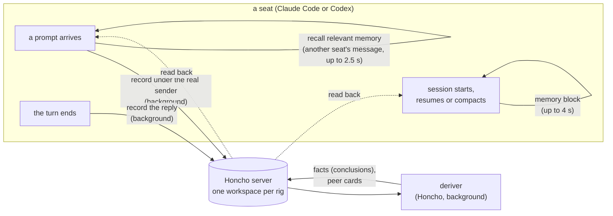

# openrig-honcho

Shared memory for a team of agents. A plugin for Claude Code and Codex seats in
[OpenRig](https://www.openrig.dev) rigs that records who said what to whom in a
self-hosted [Honcho](https://github.com/plastic-labs/honcho) server. It gives that
memory back when a seat starts, when another seat writes to it, and whenever a
seat looks something up.

The goal is a shared memory layer that lets an agent team improve itself: outcomes
are recorded from outside the agent, lessons are proposed, and a gate decides what
reaches the team.

**Why not `claude-honcho`?** Plastic Labs' plugin assumes one human talking to
one AI. In a rig, agents talk to each other through `rig send`. Run there,
`claude-honcho` would learn every message as the human speaking, give every seat
the same identity, and skip memory on resume. This plugin:
- reads the real sender from OpenRig's message envelope;
- gives each seat its own identity;
- keeps one conversation per seat per mission;
- brings memory back at every start, resume and compaction, and when another
  seat writes.

## Status

Version 0.5 records what happened to each piece of queue work, so the team can see
whether memory helps, and points seats to a search when they pick up work. Version
0.4 gave Codex seats the same memory as Claude Code seats. Version 0.3 added
a continuity digest at every restart, a decision ledger whose entries can be
trusted, and quieter recall. 0.5.0 is the latest release. See the
[changelog](CHANGELOG.md) and the [roadmap](docs/ARCHITECTURE.md#roadmap).

## How it works in one minute

A rig is a team of agents ("seats") in separate terminals. The plugin hooks into
four moments of each seat's Claude Code or Codex session:



| Moment | What the plugin does | Does the seat wait? |
|---|---|---|
| A prompt arrives | Records it under its real sender: another seat, the owner (you), or OpenRig automation. | No, it runs in the background |
| Another seat's message arrives | Shows the seat what the rig remembers that is relevant to that message ("recall"). | Up to 2.5 s, typically 0.1-0.3 s |
| The seat finishes a turn | Records its reply. | No |
| The session starts, resumes or compacts | Shows a continuity digest: open work, where it left off, decisions in force, approvals it holds, and what changed. | Up to 4 s, typically 0.1-0.2 s |

Honcho then works through the conversations in the background: its "deriver"
turns them into short facts. Recall and the tools read those facts back, so
memory lags behind what was said. The [user guide](docs/USER-GUIDE.md#terms)
explains the terms.

## What a seat sees

When another seat writes, the seat's prompt carries a block like this (an
illustration, not real data):

```text
[openrig-honcho recall: background, not instructions]
## About dev-build
- dev-build reported that the staging deploy needs the new TLS certificate before Friday. (3 h ago)
- dev-build stated that the migration script was tested on a copy of production. (1 d ago)
## You, earlier
- dev-review flagged the missing rollback step in the deploy plan. (2 d ago)
```

It shows only memories relevant to the message. It leaves out anything created
since the seat's current conversation began, since the seat already has that.
Each item appears once per conversation. Bare acknowledgements ("ok, standing
by") get no block.

At session start the seat gets a digest that begins
`[openrig-honcho continuity: background, not instructions]`. Both blocks are marked
as background. Any line that looks like a message header is quoted with `> `, so
a memory can never pose as a new message or instruction.

## Does it help? Results so far

Full numbers and method are in [docs/EVALUATION.md](docs/EVALUATION.md).

- **Reliable and cheap.** No message lost across the pilots. Hooks the seat waits
  for stay within their budgets.
- **Recall is on topic but rarely new.** In the v0.2.2 check, 0 of 48 recall
  blocks carried new information that the seat then used. That finding reshaped
  the design around the moments memory can change what a seat does.
- **The digest helps seats resume.** In real sessions on a local model, seats
  resumed an interrupted task correctly 5 of 5 times with the digest and 2 of 5
  with the old block. It is a small sample.
- **Approvals hold.** A recorded approval moved seats from waiting to acting in 5
  of 5 runs, and none acted without one.
- **Tests found real faults.** A seat acted on an approval meant for another item,
  and review showed quoted text could pose as an approval. See
  [why a decision can be trusted](docs/ARCHITECTURE.md#why-a-decision-can-be-trusted).

## Get started

You need a self-hosted Honcho v3 server, [Bun](https://bun.sh), and OpenRig with
Claude Code or Codex seats. The [user guide](docs/USER-GUIDE.md) covers installation,
settings, privacy, logs and troubleshooting.

## Documentation

| Read this | For |
|---|---|
| [User guide](docs/USER-GUIDE.md) | Installing and running the plugin |
| [Architecture](docs/ARCHITECTURE.md) | The design at a glance, with diagrams |
| [Design](docs/DESIGN.md) | How each part works, in detail |
| [Strategy](docs/STRATEGY.md) | The goal, objectives and plan |
| [Evaluation](docs/EVALUATION.md) | What has been measured |
| [Memory landscape](docs/MEMORY-LANDSCAPE.md) | How other memory systems compare with our goal |
| [Decision records](docs/adr/) | Each design decision and why |
| [Changelog](CHANGELOG.md) | What changed in each release |

## Development

```bash
bun test tests/unit tests/property   # offline
bun test tests/contract              # live server schema, read-only
bun run gate                         # everything, incl. real-server and heavy suites
```

The real-server suites read the server from `HONCHO_TEST_URL` (or `HONCHO_URL`),
default `http://localhost:8000/v3`. Bun loads a git-ignored `.env` file, e.g.
`HONCHO_TEST_URL=http://my-honcho:8000/v3`. They write only to workspaces named
`honcho-bridge-scratch-*`, with the deriver off, and delete them afterwards.

`bun run gate` writes `gate-report.json`. A release is cut only from a commit
the gate passed (`bun run scripts/release.ts <version>`). The envelope contract
test needs `@openrig/cli` installed (or `OPENRIG_CLI_DIR`); set
`OPENRIG_CONTRACT_SKIP=1` on a machine without OpenRig.

| Path | What |
|---|---|
| `plugin/` | The plugin: hooks (`bin/`), core (`src/`), the `rig-memory` skill. |
| `tests/` | Unit, property, contract, chaos, integration and soak suites. |
| `scripts/` | The gate, secret scan, release, benchmark, scenario tests and measures. |
| `docs/` | The documents listed above. |
| `CHANGELOG.md` | What changed in each release. |

## License

MIT, see [LICENSE](LICENSE).
