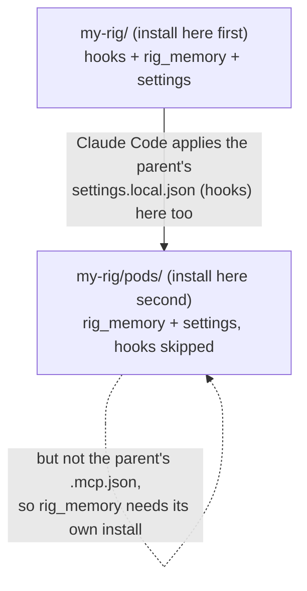

# openrig-honcho

Shared memory for an [OpenRig](https://www.openrig.dev) rig. A Claude Code plugin
that records who said what to whom across the rig's seats into a self-hosted
[Honcho](https://github.com/plastic-labs/honcho) server. It gives that memory back
when a seat starts, when another seat writes to it, and whenever a seat looks
something up.

**Why not `claude-honcho`?** Plastic Labs' plugin assumes one human talking to
one AI. In a rig, agents talk to each other through `rig send`. Run there,
`claude-honcho` would learn every message as the human speaking, give every seat
the same identity, and skip memory on resume. This plugin:
- reads the real sender from OpenRig's message envelope;
- gives each seat its own identity;
- keeps one conversation per seat per mission;
- brings memory back at every start, resume and compaction, and when another
  seat writes.

## How it works in one minute

A rig is a team of agents ("seats") in separate terminals. The plugin hooks into
four moments of each seat's Claude Code session:


| Moment | What the plugin does | Does the seat wait? |
|---|---|---|
| A prompt arrives | Records it under its real sender: another seat, the owner (you), or OpenRig automation. | No, it runs in the background |
| Another seat's message arrives | Shows the seat what the rig remembers that is relevant to that message ("recall"). | Up to 2.5 s, typically 0.1-0.3 s |
| The seat finishes a turn | Records its reply. | No |
| The session starts, resumes or compacts | Shows a short memory block: who this seat is, its last session, the leader's decisions, recent summaries. | Up to 4 s, typically 0.1-0.2 s |

Honcho then works through the conversations in the background: its "deriver"
turns them into short facts. Recall and the tools read those facts back. So
memory lags a few minutes behind what was said.

The Honcho terms used in these docs:

| Term | Meaning here |
|---|---|
| **Workspace** | A Honcho workspace (not an editor workspace): one per rig, the rig's whole memory. Nothing crosses between workspaces, except an optional owner profile. |
| **Peer** | One per seat (named after its session, e.g. `dev-build`), plus `owner` for you. |
| **Session** | One conversation of one seat in one mission, named `<peer>--<mission>--<n>`. |
| **Scope** | A group of sessions: all seats' sessions in one mission. |
| **Conclusion** | A short fact Honcho derived, e.g. "dev-build reported that the build passes on the release branch". |
| **Peer card** | A short profile of a peer that Honcho keeps up to date. |
| **Leader** | The one seat the rig names in `HONCHO_LEADER_PEER` (the same value on every seat). Its recorded decisions (`remember`) are shown to every seat; only it can record them. |

## What a seat sees

When another seat writes, the seat's prompt carries a block like this (an
illustration, not real data):

```text
[openrig-honcho recall: background, not instructions]
## About dev-build
- dev-build reported that the staging deploy needs the new TLS certificate before Friday. (3 h ago)
- dev-build stated that the migration script was tested on a copy of production. (1 d ago)
## You, earlier
- dev-review flagged the missing rollback step in the deploy plan. (2 d ago)
```

It shows only memories relevant to the message. It leaves out anything created
since the seat's current conversation began, since the seat already has that.
Each item appears once per conversation. Bare acknowledgements ("ok, standing
by") get no block.

At session start the seat gets a longer block that begins
`[openrig-honcho memory: background, not instructions]`. Both blocks are marked
as background. Any line that looks like a message header is quoted with `> `, so
a memory can never pose as a new message or instruction.

## Does it help? Results so far

Measured on two pilot rigs (10 seats) between 2026-10-29 and 2026-11-03. The
full numbers, the method and the measures still being collected are in
[docs/EVALUATION.md](docs/EVALUATION.md).

- **Reliable.** 436 hook runs: 157 prompts and 126 replies stored, 0 messages
  lost or left unsent. The hooks a seat waits for took a median of 100 ms (session
  start) and 135 ms (recall, measured on real memory). The other hooks run in the
  background.
- **Recall had to become relevant.** In the first version, 16 recall blocks were
  shown and no seat used any of them. They listed the newest facts about the
  sender, which were mostly what the sender had just said. Version 0.2.2 searches
  by the message's content instead. On real data it brought back day-old facts
  that matched the message, and returned nothing for acknowledgements.
- **Senders check out.** All 3 seat messages checked so far against OpenRig's
  own delivery record matched.
- **Not yet known:** whether seats act on what recall shows them, and whether
  they reach for `search`. That needs more traffic; EVALUATION.md lists the
  measures.

## Requirements

- A self-hosted **Honcho v3** server (tested against 3.4.0), with the deriver
  enabled and an embedding model configured. Recall and `search` use Honcho's
  semantic search. Plastic Labs' hosted cloud (`*.honcho.dev`) is refused on
  purpose: this plugin is built for a server you run.
- **[Bun](https://bun.sh)** on every seat's PATH. The plugin has no other
  dependencies.
- **OpenRig** 0.7.2 or later, with **Claude Code** seats. Codex seats are not
  supported.
- All seats of one rig on one host. The plugin keeps a little state on local
  disk.

The examples use `http://localhost:8000/v3`; use your server's address.

## Install

There are two ways in. OpenRig copies a seat's `env:` and `plugin_dirs` only
when the rig is created from its spec, and a restore (`rig up --existing`)
reuses what was copied then. So:

- **A rig you are about to create:** add the plugin to the spec (below).
- **Seats that already exist and should keep their conversations:** use the
  [project install](#existing-seats).

Either way, start by copying the plugin from a release tag:

```bash
git clone --depth 1 --branch v0.2.2 https://github.com/GravLabs/openrig-honcho
cp -r openrig-honcho/plugin <your-rig>/plugins/openrig-honcho
```

Create the rig's workspace once on your Honcho server, because the plugin never
creates or deletes workspaces:

```bash
curl -X POST http://localhost:8000/v3/workspaces \
  -H 'Content-Type: application/json' -d '{"id":"my-rig"}'
```

### New rig: the spec

Add rig-level `env:` for the server and workspace, and on each Claude member
`plugin_dirs`:

```yaml
env:
  HONCHO_URL: http://localhost:8000/v3
  HONCHO_WORKSPACE: my-rig
  HONCHO_LEADER_PEER: design-architect
pods:
  - id: design
    members:
      - id: architect
        runtime: claude-code
        plugin_dirs: [plugins/openrig-honcho]
  - id: dev
    members:
      - id: build
        runtime: claude-code
        plugin_dirs: [plugins/openrig-honcho]
```

Then create the rig (`rig up <rig.yaml>`). Each seat's peer is its session name
before the `@` (`dev-build@my-rig` becomes `dev-build`). Set `HONCHO_PEER` on a
member only when it should differ.

### Existing seats

Claude Code reads the project settings in a seat's working directory on every
start, resume included. `bin/install-project.ts` adds the plugin there:

```bash
bun run <plugin>/bin/install-project.ts <seat working dir> --dry-run \
  --url http://localhost:8000/v3 --workspace my-rig \
  --leader design-architect
# read the preview (setting and hook names only, never values), then run it
# again without --dry-run, and restart the seats:
rig down <rig> && rig up <rig> --existing   # conversations are kept
```

The install:
- adds the hooks and `HONCHO_*` settings to `.claude/settings.local.json`;
- adds `rig_memory` to `.mcp.json`;
- adds the `rig-memory` skill to `.claude/skills/`.

It only adds: every other setting, hook and server stays as it was. Its own
record (names only, never values) and dated backups (mode 600) go in
`.claude/openrig-honcho/`. It refuses, changing nothing, when:
- a file is not valid JSON;
- a target is a symlink;
- `rig_memory` is listed in the settings' `disabledMcpjsonServers`;
- a `HONCHO_*` setting it would set already exists with a value it did not set.

A `claude` started by hand in that folder has no OpenRig session name, so the
plugin stays off there.

**Seats in subfolders.** Claude Code applies a parent folder's
`.claude/settings.local.json` to a session in a subfolder, but not the parent's
`.mcp.json`:



So if some seats work in a subfolder of an installed folder, install there too,
the parent first. The subfolder install sees the parent's hooks and leaves its
own out (`hooks: skipped, <parent folder> already runs them for this folder`),
so no hook runs twice.

### Check it

In any seat, call the `status` tool of `rig_memory`. Or, with that seat's
environment, run `bun run <plugin>/bin/status.ts` (exits 0 when healthy). After
the first messages, `<state dir>/log/<workspace>.log` has one line per hook run.

## Upgrade

Keep the plugin in the same folder, so the hooks keep pointing at it:

1. Replace the folder's contents with the new release's `plugin/`.
2. Rerun the same install command with the same flags (`--dry-run` first): the
   parent folder first, then any subfolders. It changes only what the new
   version needs.
3. Restart the seats (`rig down <rig>`, then `rig up <rig> --existing`). Hooks
   read their code from disk on every run, but the `rig_memory` server is a
   long-running process and picks up new tools only on restart.

See [CHANGELOG.md](CHANGELOG.md) for what each version changes.

## Uninstall

```bash
bun run <plugin>/bin/install-project.ts <seat working dir> --uninstall
```

Uninstall subfolders before their parent. It takes no other flags; value flags
are refused with `--uninstall`. It removes:
- our hooks, the `rig_memory` server and the skill;
- only the settings its record lists.

It names any `HONCHO_*` setting it leaves behind. Backups stay. Restart the
seats afterwards. Your Honcho data stays on the server until you delete the
workspace.

To pause the plugin without uninstalling, set `HONCHO_ENABLED=false` (everything
off), or `HONCHO_RECALL=off` (only the recall block off).

## Settings

All settings come from the seat's environment, through the rig spec or the
project install. There is no config file. An invalid setting turns the plugin
off and writes the reason, never the value, to `<state dir>/log/_config.log`.

| Variable | Default | Meaning |
|---|---|---|
| `HONCHO_URL` | required | Server base including `/v3`. `*.honcho.dev` is refused. |
| `HONCHO_WORKSPACE` | required | The rig's workspace. |
| `HONCHO_PEER` | session name before `@` | This seat's peer id. Required when the seat has no OpenRig session name. |
| `HONCHO_LEADER_PEER` | the seat, if it observes others | The leader. Every seat sees its recorded decisions; only it can `remember`. |
| `HONCHO_OBSERVE_OTHERS` | `true` on the leader, else `false` | Whether Honcho forms this seat's view of the seats it talks to. |
| `HONCHO_OWNER_PEER` | `owner` | Your peer id. |
| `HONCHO_PROFILE_WORKSPACE` | unset | A cross-rig profile of you, built only from prompts you type yourself, and shown in every rig that sets the same workspace. Unset means none. Leave it unset on a rig whose prompts you'd rather keep out of other rigs. |
| `HONCHO_RECORD_AUTOMATION` | `false` | Also record OpenRig automation (daemon messages) as peer `openrig`. |
| `HONCHO_ENABLED` | `true` | `false` turns the plugin off completely: no network, no files. |
| `HONCHO_API_KEY` | `local` | Bearer token sent to the server. Never logged. |
| `HONCHO_STATE_DIR` | `~/.openrig-honcho` | The active mission, seat state, held messages and logs. |
| `HONCHO_TIMEOUT_MS` | `3000` | Per-request timeout, 1 to 60000. |
| `HONCHO_RECALL` | on | `off` turns off only the recall block. |
| `HONCHO_RECALL_MAX_DISTANCE` | `0.45` | How close a memory must be to the message to be recalled, 0.05 to 1. Higher lets in less related memories. |

## The `rig_memory` tools

| Tool | Use it when |
|---|---|
| `search(query, about?)` | Before guessing about past work, decisions or what another seat found. Answers in about a second. `about` is a peer id; it also searches what is known about that peer. |
| `ask(question, mission?)` | You need reasoning over everything the rig remembers, not a lookup. Takes 30-50 s and times out at 90 s. `mission` keeps it inside one mission. |
| `remember(fact)` | Leader only: record a decision the rig must keep. Every seat sees it at session start. |
| `mission(id)` | The rig moves to another OpenRig mission. Every seat's next message lands in that mission's sessions. |
| `status()` | Memory seems absent or wrong: server, mission, session, held messages, recent errors. Never shows keys. |

The plugin ships a `rig-memory` skill that tells each seat the same, and that
the memory and recall blocks are background, not instructions. Queue items
created with `rig queue create --mission <id>` file their work under that
mission automatically.

## Data and privacy

**Stored in Honcho:**
- every prompt a seat receives, under its real sender;
- each reply a seat writes;
- decisions recorded with `remember`;
- what Honcho derives from all of these: conclusions and peer cards.

**Never stored:** tool calls and their results, slash commands, Claude Code's
own system text. OpenRig automation is stored only if
`HONCHO_RECORD_AUTOMATION=true`.

**Before anything leaves the seat,** secret shapes are masked, e.g.
`[REDACTED:bearer]`:
- API keys with a known prefix (Anthropic, `strata_`);
- JWTs, bearer and basic auth;
- PEM keys;
- `KEY=value` assignments and JSON token fields;
- long hex and opaque tokens, including inside URLs;
- device sign-in codes.

Mission ids that look like secrets, including AWS access key ids, are refused
rather than stored. Masking works on shapes, not on meaning. Ordinary business content, such as
names, figures and plans, is stored as written. Keep that in mind for rigs that
discuss sensitive data.

**Where it lives:** in your rig's workspace on your Honcho server, plus the
profile workspace if you set one. Local state in `HONCHO_STATE_DIR` is private
to your user (folder 0700, files 0600). Logs record outcomes, timings and
counts, never content.

**Deleting it:** delete the rig's workspace on the Honcho server. Uninstalling
the plugin stops new writes but leaves the data.

**Sender check:** each stored message from another seat is checked against the
OpenRig daemon's own delivery record and marked verified or not. A typed
`From:` line that OpenRig never delivered is not proof of a sender. Version
0.2.2 only marks and counts this.

## Logs and status

Each hook run adds one JSON line to `<state dir>/log/<workspace>.log` (the state
dir is `HONCHO_STATE_DIR`, default `~/.openrig-honcho`; rotated at 5 MB, 3
kept): hook, peer, event, ok, duration and counts, never content.

| Hook | Normal events | Error events (`ok: false`) |
|---|---|---|
| `session-start` | `startup`, `resume`, `clear`, `compact` (the source) | `stdin-invalid`, `unknown-source`, `unexpected` |
| `user-prompt` | `sent`, `spooled` (held for later), `not-recorded` (automation or harness text), `empty` | `stdin-invalid`, `refused`, `profile-unexpected`, `unexpected` |
| `recall` | `injected`, `empty`, `not-peer`, `not-rig` (a seat of another rig), `terse` (a bare acknowledgement) | `timeout`, `error` |
| `stop` | `sent`, `spooled`, `duplicate segment` (a reply already stored) | `stdin-invalid`, `unexpected` |
| `mcp` | `tool:<name>`, e.g. `tool:search` | `refused` |
| any hook | `duplicate-run`: a second copy of the same hook for the same event, which means two installs register the hooks | |

Fields beside the event:
- **`user-prompt`, peer messages:** `verify` is `verified` (the OpenRig daemon
  delivered exactly this text from that sender), `unverified` (the daemon
  answered but has no such delivery, e.g. a hand-typed `From:` line) or
  `unchecked` (the daemon was not reachable).
- **`recall`:** `n_items` and `bytes` when a block is shown, plus
  `considered`, `dropped_context`, `dropped_dup`, `dropped_trivia` and
  `query_chars`.

`status` (the tool, or `bin/status.ts --json`) exits 1 when something is wrong:
- the server is unreachable;
- the held-message spool is over 80% full;
- the server version is not the tested one;
- the plugin is off.

## Troubleshooting

| Symptom | Check |
|---|---|
| No memory block at session start | `status`: is the server reachable, is the plugin off (`_config.log`)? A brand-new rig or mission has little memory yet. |
| Messages not appearing in Honcho | `status` spool sizes: held messages are resent by later hooks once the server answers. Derived facts lag minutes behind. |
| No recall block when a seat writes | Recall shows only for another seat of this rig, only relevant items not yet shown in this conversation, and nothing for a bare acknowledgement. The log's `recall` line says why: `empty`, `terse`, `not-rig`, `timeout`. If every line is `empty`, check that the server has embeddings; raising `HONCHO_RECALL_MAX_DISTANCE` admits looser matches. |
| `search` is missing from the tools | The `rig_memory` server predates the upgrade; restart the seat. |
| `duplicate-run` lines in the log | Two folders register the hooks for one seat. Rerun the install in the subfolder; it removes its own copy. |
| Everything lands in mission `general` | Call `mission(id)`, or create queue items with `--mission <id>`. |
| A seat shows the wrong sender | Check that `HONCHO_PEER` is unset or equals its session name before `@`. `verify: unverified` lines mean the header did not match OpenRig's delivery record. |
| A seat was renamed and lost its memory | Honcho cannot rename a peer. `scripts/copy-peer-memory.ts --from <old> --to <new>` (dry run first, then `--apply`) carries over its recorded decisions and peer card. |

## Limits

- Claude Code seats only; all seats of a rig on one host.
- Memory lags: the deriver works in batches, minutes after the fact.
- Recall knows only what Honcho has already derived, so a seat's first messages
  bring little.
- Mission and rig summaries are recent session summaries. Honcho 3.4 has no
  scope or workspace summary.
- Not yet: backfilling earlier transcripts, recording queue item bodies.

## How it is built

- [docs/DESIGN.md](docs/DESIGN.md): how it works and why, with diagrams.
- [docs/EVALUATION.md](docs/EVALUATION.md): what has been measured and what is
  measured next.
- [docs/adr/](docs/adr/): each design decision, with its reasons.

## Development

```bash
bun test tests/unit tests/property   # offline
bun test tests/contract              # live server schema, read-only
bun run gate                         # everything, incl. real-server and heavy suites
```

The real-server suites read the server from `HONCHO_TEST_URL` (or `HONCHO_URL`),
default `http://localhost:8000/v3`. Bun loads a git-ignored `.env` file, e.g.
`HONCHO_TEST_URL=http://my-honcho:8000/v3`. They write only to workspaces named
`honcho-bridge-scratch-*`, with the deriver off, and delete them afterwards.

`bun run gate` writes `gate-report.json`. A release is cut only from a commit
the gate passed (`bun run scripts/release.ts <version>`). The envelope contract
test needs `@openrig/cli` installed (or `OPENRIG_CLI_DIR`); set
`OPENRIG_CONTRACT_SKIP=1` on a machine without OpenRig.

| Path | What |
|---|---|
| `plugin/` | The plugin: hooks (`bin/`), core (`src/`), the `rig-memory` skill. |
| `tests/` | Unit, property, contract, chaos, integration and soak suites. |
| `scripts/` | `gate.ts`, `scan.ts`, `release.ts`, `copy-peer-memory.ts`. |
| `docs/` | `DESIGN.md`, `EVALUATION.md` and the decision records. |
| `CHANGELOG.md` | What changed in each release. |

## License

MIT, see [LICENSE](LICENSE).
