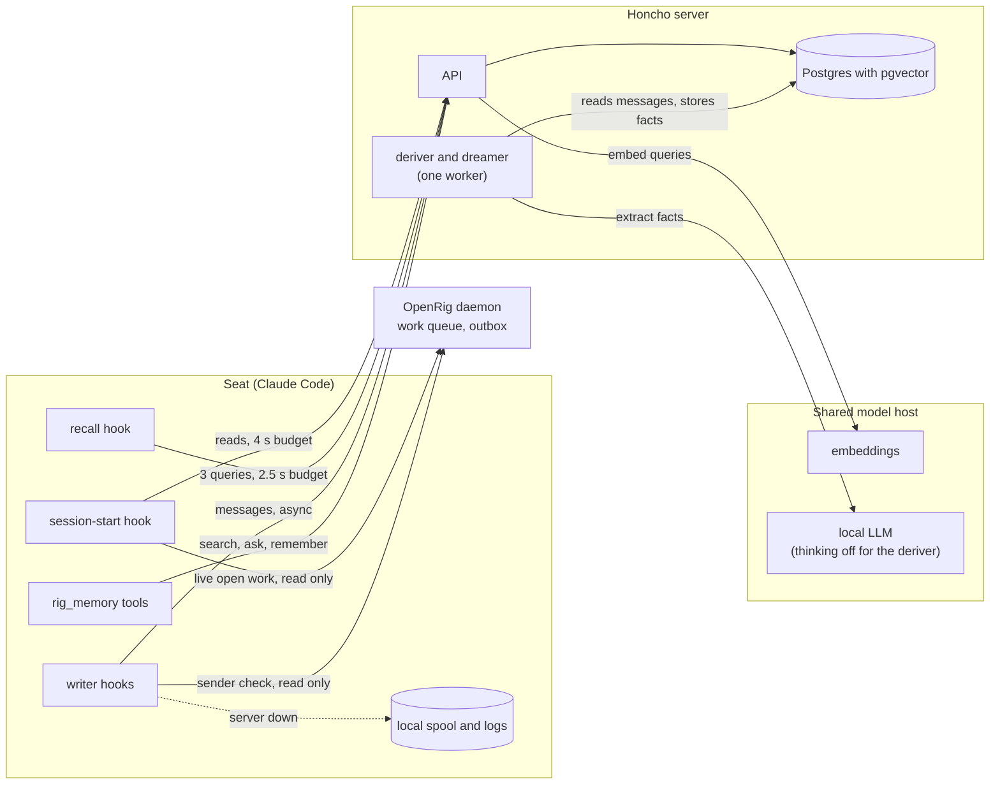
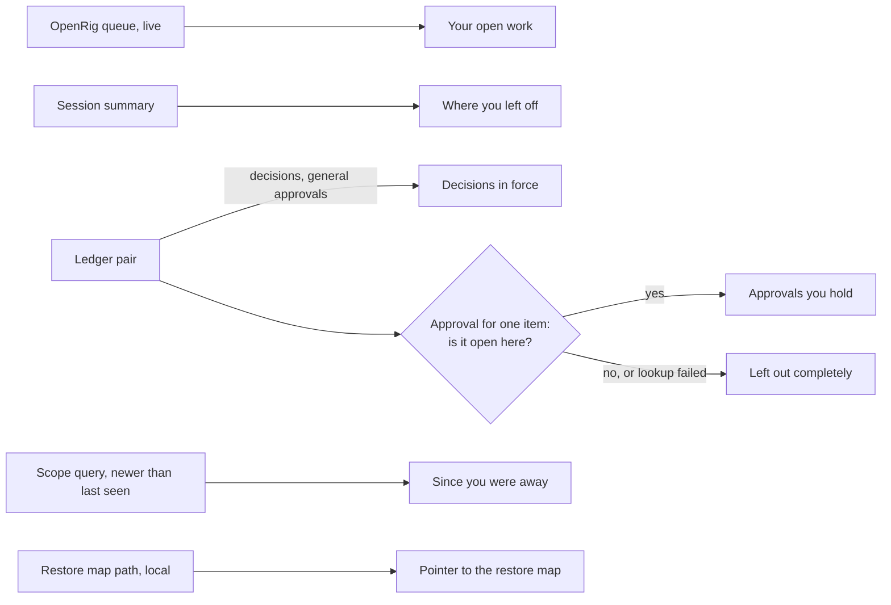
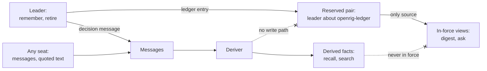
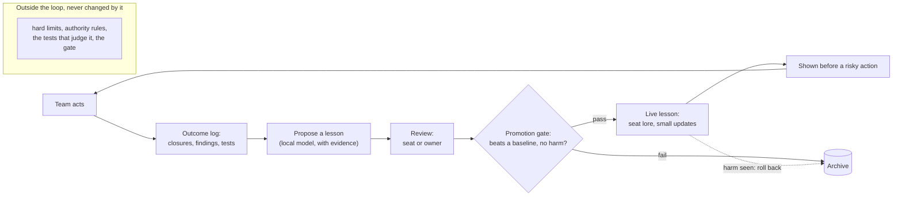
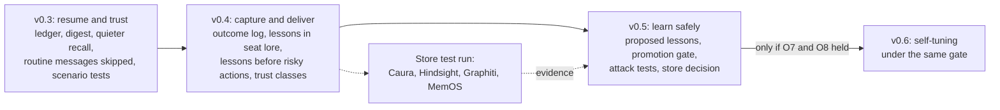

# openrig-honcho architecture

The design at a glance. For how each part works in detail, see
[DESIGN.md](DESIGN.md). For the goal and the objectives, see
[STRATEGY.md](STRATEGY.md).

A Claude Code plugin gives a team of agents shared memory on a self-hosted Honcho
server. The goal is a memory layer that lets the team improve itself: outcomes
come from outside the agent, lessons are proposed, and a gate decides what reaches
the team.

Snapshot: 2026-11-05, with version 0.3 in development.

## How the pieces connect

The plugin lives inside each seat as hooks and tools. Reads the seat waits for have
strict time budgets. Writes run in the background and spool to disk if the server
is down.

Current state comes live from OpenRig, never from memory. The deriver runs in the
background, so a new fact appears some time after its message.

## When memory reaches a seat

Seats rarely look things up: one search in 2.5 days across 10 seats. So memory is
pushed at the moments it can change what a seat does.

| Moment | What the seat sees | Status |
|---|---|---|
| Startup, resume, compaction | Continuity digest, about 2 500 characters | v0.3 |
| Another seat writes | Recall, only what its transcript lacks; nothing if under 2 items | v0.3 |
| On demand | `search` and `ask` | Released |
| Before a risky action | Lessons matched to that action | v0.4 |

## How the digest is built

Each part comes from the source that owns it, in parallel, and a late or failed
part is left out. An approval for a queue item shows only if that item is in the
seat's own open work.

In a scenario test with an approval for a different item, seats published 5 of 5
times. With this check, they waited 5 of 5 times.

## Why a decision can be trusted

A fact in memory may be a paraphrase, a quote or a mistake. So authority comes from
where an entry is stored, never from what its text says. Only the leader's tools
write to the reserved pair, and it is the only place in-force views read.

This closes a hole the v0.3 review proved: quoted text could fabricate an approval.
The move to the reserved pair is being built now.

## The learning loop

The store is not the hard part. A rig already has what most memory systems lack:
evidence from outside the agent. The loop is built on that evidence, because a
model grading its own work can spread a false lesson to the whole team.

The ideas come from ACE (itemized playbooks), ReasoningBank (learning from
failures), the Darwin Gödel Machine (evaluate before keeping) and Caura (outcome
rules), redesigned for this project and not copied. See
[MEMORY-LANDSCAPE.md](MEMORY-LANDSCAPE.md).

## Roadmap

Each release is judged on measured objectives before the next. The store decision
is made on evidence, by running other stores through the same tests.

Honcho stays until that test run says otherwise. The loop sits above the store, so
that work survives a change of store.

## What the tests have shown so far

Real sessions on the local model, 5 runs per arm, scored by fixed checks. The
samples are small, so these show direction, not proof.

| Test | Result |
|---|---|
| Resume an interrupted task, with the digest | 5 of 5 |
| Resume an interrupted task, with the old block | 2 of 5 |
| Act on an approval held for this item | 5 of 5 |
| Wait when no approval exists (control) | 5 of 5 |
| Wait when the approval is for another item, after the fix | 5 of 5 |

On the 45-question benchmark, the ledger took outdated items shown on decision
questions from 1 to 0, with no right answer lost. Full results are in
[EVALUATION.md](EVALUATION.md).
