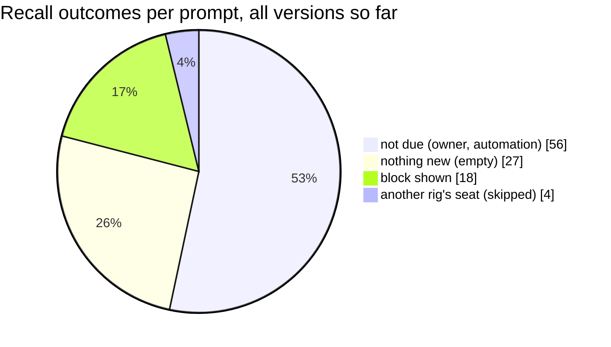

# openrig-honcho: evaluation

What has been measured about the plugin in real use, how, and what is measured
next. All figures are aggregates from the plugin's own logs. Those logs hold
outcomes, timings and counts, never content. The figures come from two pilot
rigs: 10 Claude Code seats, a mix of a hosted model and a local model, from
2026-10-29 to 2026-11-03. Pilot rigs are not named, and no conversation content
is quoted.

## 1. Method

- **Source.** Each hook run writes one JSON line to
  `<state dir>/log/<workspace>.log`: hook, peer, event, ok, duration in ms, and
  counts such as items, bytes and `considered`. Section 7 has a
  [script](#7-reproducing-the-numbers) that recomputes the run counts, the
  event table and the median and 95th percentile per hook from those files.
  The other figures come from the same logs or from the read-only checks
  described where they appear.
- **Usefulness checks.** Recall is judged by reading the seats' replies after a
  recall block and asking whether the seat referred to or acted on a recalled
  item. That is a manual, read-only review of the transcripts, reported as
  counts only.
- **Latency.** Two measures:
  - *in-hook time*: the hook's own timer, from the log;
  - *wall time*: spawn to exit of the real hook process, the way Claude Code
    runs it, from the release's `LATENCY.md`.
- **Tests** run separately, against scratch workspaces only (see
  [DESIGN.md section 12](DESIGN.md#12-how-it-is-tested)).

## 2. Reliability

| Measure | Value |
|---|---|
| Hook runs logged | 436 |
| Prompt hook runs | 165 (157 prompts stored; the rest were empty or automation) |
| Replies stored | 126 |
| Messages held for later (spooled) | 0 |
| Messages lost | 0 |
| Runs with `ok: false` | 4 (0.9%), all from before v0.2.0, when deliberately skipped prompts were logged as failures; fixed in v0.2.0 |
| Duplicate hook runs (`duplicate-run`) since v0.2.1 | 0 |

One pilot rig had registered the hooks twice, through a parent and a subfolder
install, before v0.2.1. One prompt was stored twice before that was found. That
led to ADR-0010.

## 3. Latency

In-hook time from the logs, all versions:

| Hook | Does the seat wait? | Runs | Median | 95th percentile | Max |
|---|---|---|---|---|---|
| `session-start` | yes (4 s budget) | 29 | 100 ms | 181 ms | 182 ms |
| `recall` | yes (2.5 s budget) | 105 | 10 ms | 42 ms | 571 ms |
| `user-prompt` (writer) | no | 165 | 53 ms | 149 ms | 174 ms |
| `stop` (writer) | no | 126 | 37 ms | 69 ms | 83 ms |

Most recall runs return in about 10 ms, because they decide locally that no
recall is due: the prompt is from the owner, automation, or a seat of another
rig. When recall does run, the cost depends on the version:

| Recall, when it shows a block | v0.2.0 (newest first) | v0.2.2 (by relevance) |
|---|---|---|
| In-hook time | 22-44 ms (16 blocks) | 102-183 ms in a controlled run; 264 and 571 ms for the first two pilot blocks |
| Wall time, spawn to exit | about 30 ms (scratch workspace) | 112-198 ms, median about 135 ms (real memory, read-only) |
| Acknowledgement (no block) | the full query | 15-18 ms, no network |

The added time buys three semantic queries per peer message. That is well
inside the 2.5 s budget, and if one query is slow, the ones that finished are
still shown.

## 4. Recall: why it changed

### v0.2.0: newest facts about the sender

The first usefulness check covered one pilot rig over about a day, from the
v0.2.0 install on:

| Measure | Value |
|---|---|
| Prompts | 76 |
| From another seat (recall due) | 43 (57%) |
| Recall blocks shown | 16, sized 362-1 328 characters, 1-11 items |
| Blocks a seat visibly referred to or acted on | 0 of 16 |
| `ask` calls | 0, before and after |



Reading the 16 blocks showed why none was used:
- most items were what the sender had just said, often in the very message
  being read;
- some only said that a tool had been used;
- three blocks were about a seat of another rig, and wrong.

The rare useful item, an older state fact, was buried among them.

### v0.2.2: relevant facts, minus what the seat already has

Version 0.2.2 sends the message's content as a semantic query and keeps only
close matches. It leaves out anything created since the seat's current
conversation began. It never runs for acknowledgements or for seats of other
rigs. The closeness cutoff was calibrated on real memory with five kinds of
query, counting the results returned at each cutoff (more of 8 = more
returned):

| Query | 0.30 | 0.35 | 0.40 | 0.45 | 0.50 | 0.60 |
|---|---|---|---|---|---|---|
| On-topic, an infrastructure step | 3 | 8 | 8 | 8 | 8 | 8 |
| On-topic, a configuration change | 2 | 8 | 8 | 8 | 8 | 8 |
| On-topic, a review result | 0 | 0 | 0 | 1 | 8 | 8 |
| An acknowledgement ("standing by") | 0 | 0 | 0 | 0 | 1 | 8 |
| An unrelated question | 0 | 0 | 0 | 0 | 0 | 0 |

At 0.45, on-topic messages get matches and acknowledgements get none. That is
the default (`HONCHO_RECALL_MAX_DISTANCE`). The reference plugin's 0.6 let every
acknowledgement through.

In a controlled run against real memory, every on-topic message got a block of
7-11 items. The items included day-old facts directly about the step the
message concerned, and under `## You, earlier` the seat's own earlier decision
on it.

### v0.2.2 so far: too early to judge

| Measure (since the v0.2.2 install) | Value |
|---|---|
| Prompts | 22 |
| Recall blocks shown | 2, 4 items each |
| Seats of another rig, correctly skipped | 4 |
| `search` calls | 0 |
| Seat messages checked against OpenRig's delivery record | 3, all verified |

Traffic since the upgrade is too low to say whether seats use what recall shows
them. Section 5 lists what is measured as traffic grows.

## 5. Measures being collected

| Measure | Definition | Why it matters | Source | Status |
|---|---|---|---|---|
| Recall rate | blocks shown / messages from another seat of the rig | Too low: recall rarely helps. Too high on thin messages: noise. | `recall` events | logged |
| Use rate | blocks after which the seat referred to or acted on a recalled item / blocks shown | The real question: does recall change what a seat does? v0.2.0: 0 of 16. | transcripts, manual review | collected per usefulness check |
| Items per block, and what was dropped | `n_items`; `dropped_context`, `dropped_dup`, `dropped_trivia` / `considered` | Shows whether the filters remove noise or real facts. | `recall` events | logged since v0.2.2 |
| Lookup rate | `search` and `ask` calls per seat per day | Whether seats look things up instead of guessing. v0.2.0: `ask` 0. | `mcp` events | logged |
| Sender match rate | `verified` / (`verified` + `unverified`) | If near 100%, a later version can record an unverified header as an unknown sender. | `user-prompt` `verify` | logged since v0.2.2 |
| Mission coverage | share of messages stored outside mission `general` | Memory grouped by mission makes recall and `ask` sharper. | session names on the server | proposed |
| Memory lag | time from a message to the first conclusion derived from it | Sets how fresh recall can be. | server, read-only | proposed |
| Latency | median and 95th percentile per hook | Recall and session start are on the seat's critical path. | all events | logged |
| Write health | spooled, dead and failed counts | Nothing should be lost. | `user-prompt`, `stop`, `status` | logged |

**What would count as "recall helps":** across at least 50 recall blocks on
two rigs, seats visibly use at least one in five. Lookups (`search` plus `ask`)
should also happen at least once per busy seat per day. Below that, recall
needs another change (for example fewer, stronger items) or should be turned
off by default.

## 6. Test evidence

From the v0.2.2 release gate, all against scratch workspaces with the deriver
off:

| Suite | Result |
|---|---|
| Unit and property (incl. 10 000 fuzzed inputs) | 1 295 passed, 0 failed |
| Contract (every call against the live server's schema) | 15 passed |
| Chaos (real hook processes against a refusing, erroring, hanging or slow server) | 18 passed |
| Integration (real server) | 23 passed |
| Heavy, incl. soak (3 seats, 300 messages, mission switches, compaction, an outage) | 28 passed |
| Secret scan of every tracked file | 0 findings |

## 7. Reproducing the numbers

Run against your own state directory. It reads only the log files and prints
counts:

```bash
bun -e '
const fs = require("fs"), path = require("path");
const dir = path.join(process.env.HONCHO_STATE_DIR ?? `${process.env.HOME}/.openrig-honcho`, "log");
const rows = fs.readdirSync(dir).filter((f) => f.endsWith(".log") && !f.startsWith("_"))
  .flatMap((f) => fs.readFileSync(path.join(dir, f), "utf8").split("\n").filter(Boolean)
    .flatMap((l) => { try { return [JSON.parse(l)]; } catch { return []; } }));
const by = {}; for (const r of rows) { const k = `${r.hook} ${r.event}`; by[k] = (by[k] ?? 0) + 1; }
console.log(rows.length, "hook runs"); console.table(by);
const ms = (h) => rows.filter((r) => r.hook === h).map((r) => r.ms).sort((a, b) => a - b);
for (const h of ["session-start", "recall", "user-prompt", "stop"]) {
  const m = ms(h); if (m.length) console.log(h, "median", m[Math.floor(m.length / 2)], "p95", m[Math.floor(m.length * 0.95)]);
}'
```
