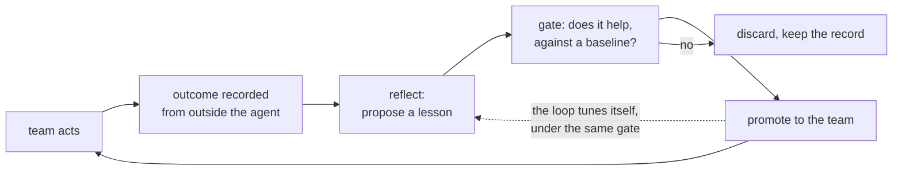

# Memory layers measured against our goal

Analysis, 2026-11-05 (design.architect, requested by the owner). It compares
each candidate with what this project needs, not with each other, and proposes
changes to the goals. The owner approved the goal, O7 and O8 and the roadmap on
2026-11-05, and decided that reflection stays on the local model. See STRATEGY.md.

**Evidence level.** Candidates were assessed from their READMEs, docs and GitHub
data. None was run. Benchmarks are the vendors' own unless stated, and no
independent multi-agent benchmark was found. Treat the ratings as where to look,
not as test results.

## 1. The goal

**A shared memory layer for agent teams that allows recursive self-improvement.**

That is more than today's goal. Today's objectives (O1-O6, STRATEGY.md) cover
remembering and not misleading. Self-improvement needs a closed loop:

Eight requirements follow:

| # | Requirement | Why |
|---|---|---|
| R1 | Continuity for each seat | Resume after context loss (O1) |
| R2 | Shared memory with scope | Seats share what they should, and only that |
| R3 | Authority and provenance | Derived text can never become a decision or permission (O4) |
| R4 | Supersession over time | Know what is true now, and what was true |
| R5 | Self-hosted on local models | Hard constraint of this project |
| R6 | Pushed at the right moment | Seats rarely look things up (1 search in 2.5 days) |
| R7 | Learning from outcomes | Successes and failures become reusable strategy |
| R8 | Gated, measured improvement | A change is kept only if it helps, and can be undone |

## 2. What the research says

- **The failure modes are ours.** "Governed Shared Memory" (2026) names four for
  agent fleets: unauthorized leakage, stale propagation, contradiction
  persistence and provenance collapse. We hit each in the last week: the
  wrong-scope approval (T20b), stale state notes (benchmark), replaced decisions
  (T19a) and forged entries (review F1).
- **Authority laundering is a known attack.** A 2026 paper on memory poisoning
  reports up to 68% success for laundering attacks against existing defenses.
  Laundering is F1's shape: untrusted text gains authority by passing through
  memory. Its answer is authority bound to origin, which is what the reserved
  ledger pair does. No candidate below advertises this.
- **Playbooks, not rewrites.** ACE keeps context as an itemized playbook updated
  by small deltas, because repeated rewriting erodes detail. It reports +10.6% on
  agent tasks and +8.6% on domain benchmarks.
- **Learn from failures too.** ReasoningBank distills strategies from successes
  and failures. Note that it uses the agent's own judgement of success.
- **Gate every change.** The Darwin Gödel Machine keeps an archive of variants and
  scores each change on real tasks before building on it.
- **Multi-agent memory is open research.** Consistency and access control are
  named open problems, and a 2026 framework notes no benchmark covers memory
  integrity under concurrent updates. Our scenario tests are unusual here.

## 3. Candidates against the requirements

● strong, ◐ partial, ○ absent or not advertised, ? unknown. Stars and licenses
are from GitHub on 2026-11-05.

| Candidate | License, stars | R1 | R2 | R3 | R4 | R5 | R6 | R7 | R8 |
|---|---|---|---|---|---|---|---|---|---|
| **Honcho + this plugin** | AGPL-3.0, 8k | ● | ● | ◐ | ◐ | ● | ● | ○ | ◐ |
| **Caura** (added later) | Apache-2.0, 0.5k | ◐ | ● | ◐ | ● | ? | ◐ | ● | ◐ |
| **Hindsight** | MIT, 59k | ◐ | ◐ | ◐ | ◐ | ● | ○ | ● | ○ |
| **MemOS** | Apache-2.0, 12k | ◐ | ◐ | ? | ? | ◐ | ◐ | ● | ◐ |
| **EverMemOS** | Apache-2.0, 14k | ◐ | ◐ | ? | ? | ? | ○ | ● | ○ |
| **Graphiti** | Apache-2.0, 33k | ○ | ◐ | ◐ | ● | ◐ | ○ | ○ | ○ |
| **Cognee** | Apache-2.0, 33k | ◐ | ◐ | ◐ | ○ | ● | ○ | ◐ | ○ |
| **Mem0** | Apache-2.0, 68k | ◐ | ◐ | ○ | ◐ | ◐ | ○ | ◐ | ○ |
| **RuVector** | MIT, 4.7k | ◐ | ○ | ◐ | ◐ | ● | ◐ | ◐ | ◐ |
| **MIRIX** | Apache-2.0, 3.5k | ◐ | ◐ | ○ | ○ | ? | ○ | ◐ | ○ |

The R6 mark for Honcho comes from our hooks. R3 and R8 come from our ledger and
tests. Honcho alone would score ○ on R6 and R8, and lower on R3.

**Honcho.** Its peer model (who observes whom, per-seat views, scopes) is the
closest match to a team, and no other candidate advertises it. Weak on learning:
the dreamer consolidates facts but knows nothing about outcomes.

**Caura** (formerly MemClaw, the code behind the governed-memory paper). Added after
the first version of this report, which missed it, and the closest match to the
goal. Scopes for agent, team and org; trust tiers; a full audit log; contradiction
detection with supersession chains; and outcome-based learning: agents report
success or failure, what works is reinforced, and failures generate preventive
`rule` memories. Per-agent retrieval tuning. Four cautions: outcomes are reported
by the agents themselves (finding 4); contradictions are superseded automatically
by a model, which ADR-0014 rejects for decisions; some admin routes exist only on
the managed platform; and the listed providers are hosted, so local-model support
needs checking. Young: created April 2026.

**Hindsight.** A strong alternative.
It separates world facts from the agent's experiences, consolidates them into
*observations* that keep evidence and a proof count and are refined rather than
overwritten, then builds mental models. Retrieval is semantic, keyword, graph and
time together, with a reranker. It runs on Ollama. Teams share a bank, with tags
to partition it, which is coarser than peers. Its docs warn that tool-based recall
only happens when the agent chooses to, as we found. Its learning is consolidation
of what was said, not outcome-driven.

**MemOS.** Closest to the end goal on paper: traces, then policies, then world
models, then crystallized skills, with feedback-driven retrieval and shared or
isolated memory. Reports agent task completion rising from 36.63% to 50.87%
(self-reported). Its local plugin targets other agent harnesses, and its multi-agent
sharing is listed under the cloud plugin, so local parity needs checking.

**EverMemOS.** Keeps agent cases and skills apart from user episodes, and evolves
memory offline between sessions. That separation is a good idea. Less is published
on governance.

**Graphiti.** The best answer to R4: bi-temporal facts, invalidated and never
deleted. It says it works best with structured-output services, and warns that
its servers do not authenticate callers across `group_id`. Local-model quality is
the main risk.

**Cognee.** `improve` applies feedback and distills sessions into a graph. Works
well on documents. Over 1 100 open issues. Runs without an LLM for basic storage.

**Mem0.** Simple, widely used, and offers a self-hosted server. It is built around
personalization for a user or agent rather than team governance.

**RuVector.** Worth reading for one idea: comparing a frozen baseline with a
candidate before adopting feedback-driven changes. It is an engine, not a memory
layer, and most claims are the project's own.

**MIRIX.** Six memory types run by dedicated agents, built for a personal assistant.

**Not a fit, and why:**
- **Letta:** a full agent runtime, which overlaps OpenRig.
- **Supermemory:** product-led service; self-hosting looks secondary. Not checked deeply.
- **Memori, memU:** license not declared in a form GitHub recognizes. Check before any use.
- **Memobase:** user profiles; little activity since January.
- **LangMem:** tied to LangGraph, though its prompt-optimization idea is relevant.
- **A-Mem:** a research prototype, little activity since 2025.
- **claude-mem** (114k stars): session capture for one user's Claude Code, not a team layer.
- **basic-memory:** Markdown with MCP, for people. Interesting beside lore, but not a team layer.
- **Beads:** a work graph for agents. It overlaps the OpenRig queue.

## 4. Findings

1. **R7 and R8 together are unmet.** Several candidates learn, and Caura learns
   from outcomes across a fleet. None offers learning from outcomes verified
   outside the agent, with a gate and rollback. Replacing Honcho would not deliver
   the end goal, though Caura comes closest and could shorten the path.
2. **R3 is unmet too.** Provenance is common, but authority bound to origin is not
   advertised anywhere. Ours exists because tests forced it.
3. **Our real asset is OpenRig, not the store.** Other systems must guess whether
   something worked, or ask the model. A rig has outside evidence: queue items
   closed or rejected, review findings, test and gate results, owner corrections.
   That is the signal a learning loop needs.
4. **Self-judged success is unsafe here.** ReasoningBank relies on it, but our
   local model has invented instructions and misdescribed its own setup, and a
   false lesson would spread to the whole team. Outcomes must come from outside
   the agent.
5. **Evaluation is the scarce part.** We already have the benchmark, scenario
   tests, the holdout and `eval-use`. Those are the gate the research calls for.

## 5. Recommendation

Keep Honcho for now, and build the learning loop above the store. The loop does
not depend on the backend, so that work survives if the store changes. Then let a
bake-off decide about the store on evidence.

### Proposed goal changes

Add to STRATEGY.md:

| # | Objective | Measure |
|---|---|---|
| O7 | **Improve from experience.** The team gets measurably better at repeated kinds of work. | Repeat-failure rate, review findings per item and time to first correct action, over time. |
| O8 | **Every change earns its place.** No lesson or tuning stays live without evidence, and all can be undone. | Share of live lessons with a passing comparison; rollback tested. |

Replace "shared memory for a rig" as the project's stated goal with the goal in
section 1.

### Proposed additions

| Item | What | Based on |
|---|---|---|
| Outcome log | Record what really happened per work item from outside sources: closure, rejection, review findings, test and gate results, owner corrections. Pointers and counts, not copies. | Finding 3 |
| Lesson candidates | After a failure or a hard success, a job proposes a lesson with its evidence. It goes to review, not into memory. | ReasoningBank, without self-judging |
| Playbook lessons | Lessons are itemized lore files changed by small deltas, with helpful and harmful counts. Never a rewrite. | ACE, ADR-0015 |
| Action-moment delivery | Before a risky action, the hook shows matching lessons. | STRATEGY phase 3 |
| Promotion gate | A lesson goes live only after a scenario or holdout shows it helps and does no harm, with an archive and rollback. | Darwin Gödel Machine, RuVector's baseline idea |
| Trust classes | Every item is marked authoritative, verified or derived, and text can never rise a class by being repeated. | Origin-bound authority |
| Poisoning tests | A standing set of laundering, leakage and stale-propagation attacks in the gate. | Governed Shared Memory |
| Evidence counts | Derived beliefs carry a proof count and are refined, not replaced. | Hindsight |
| Conflict flags | Contradictions reach the leader as proposals. Already in ADR-0014 decision 3, not yet built. | Governed Shared Memory |
| Self-tuning, last | Thresholds and digest order are tuned by the same gate, in scratch, with the owner's approval. | Recursive step |

**Limits on recursion.** The loop may change lessons and tuning. It may never
change hard limits, authority rules, the tests that judge it, or its own gate.
A system that can edit its own exam will pass it.

### Proposed deliverables

| Release | Content |
|---|---|
| v0.3 | As planned. Unchanged. |
| v0.4 | Outcome log, playbook lessons, action-moment delivery, trust classes, local checkpoints. Baseline for O7. |
| Bake-off (alongside v0.4) | Caura first, then Hindsight, Graphiti and MemOS, on the same benchmark and scenarios, on the local model. Includes cost, latency and multi-seat behaviour. |
| v0.5 | Lesson candidates, promotion gate, poisoning tests, and the store decision from the bake-off. |
| v0.6 | Self-tuning, only if O7 and O8 have held. |

## 6. What to reuse

**Rule (owner, 2026-11-05): never copy verbatim. Study the idea, then write our own
cleaner design for this project.** These are all MIT or Apache-2.0, and we credit
what we learn from. Honcho is AGPL-3.0, so read it only; none of its code enters
this MIT plugin.

| Roadmap item | Reuse | Kind |
|---|---|---|
| Lesson lifecycle | MemOS `apps/memos-local-openclaw/src/skill/` (MIT, TypeScript): generator, evaluator, validator, evolver, upgrader | Design to rework |
| Recall ranking | The same plugin's `recall/rrf.ts`, `mmr.ts`, `recency.ts`: three small files | Ideas to rework |
| Outcome loop | Caura's outcome-based learning and `rule` memories | Design, fed by outside evidence |
| Trust classes, scopes, audit | Caura's scopes, trust tiers and audit log | Design |
| Conflict flags | Caura's contradiction chains, as proposals only | Design |
| Itemized lessons | `ace-agent/ace`, `kayba-ai/agentic-context-engine`: reflector and curator prompts, delta merge | Prompts and logic |
| Lesson candidates | `google-research/reasoning-bank`: extraction prompts for success and failure | Prompts |
| Promotion gate | `jennyzzt/dgm`: the archive and evaluate-before-keep structure | Design |
| Local checkpoints | Orca's worktree checkpoints: one line on what happened and what is next. Ours are saved by the Stop hook, not written by the agent | Design |
| Bake-off harness | `mem0ai/memory-benchmarks`, LongMemEval (MIT), LongMemEval-V2 | Tools and data |

Not reusable: anything for team authority across the queue, moment-based delivery
through hooks, or OpenRig outcomes. Those remain ours.

## 7. Risks and unknowns

- **Slow signal.** Two pilots produce few repeated failures. O7 may take months to
  show, and small samples mislead. Scenario tests must carry the early evidence.
- **Local model quality** limits reflection. The owner decided it stays local, so
  team content stays on the machine.
- **Load.** Reflection and evaluation use the shared model host, as the deriver
  backlog showed.
- **Review cost.** Gated lessons need a reviewer. If that becomes the bottleneck,
  the loop stalls.
- **Ratings are unverified** until the bake-off.

## Sources

- [Governed Shared Memory for Multi-Agent LLM Systems](https://arxiv.org/abs/2606.24535)
- [Securing LLM-Agent Long-Term Memory Against Poisoning](https://arxiv.org/abs/2606.24322)
- [Agentic Context Engineering](https://arxiv.org/abs/2510.04618)
- [ReasoningBank](https://arxiv.org/abs/2509.25140)
- [Darwin Gödel Machine](https://sakana.ai/dgm/)
- [Multi-Agent Memory from a Computer Architecture Perspective](https://www.alphaxiv.org/abs/2603.10062)
- [Memory for Autonomous LLM Agents (survey)](https://arxiv.org/html/2603.07670v1)
- [AIM: Privacy-Aware Interoperable Memory](https://arxiv.org/pdf/2609.12320)
- [Caura](https://github.com/caura-ai/caura)
- [ACE code](https://github.com/ace-agent/ace), [agentic-context-engine](https://github.com/kayba-ai/agentic-context-engine), [reasoning-bank](https://github.com/google-research/reasoning-bank), [dgm](https://github.com/jennyzzt/dgm)
- [memory-benchmarks](https://github.com/mem0ai/memory-benchmarks), [LongMemEval](https://github.com/xiaowu0162/LongMemEval)
- [Hindsight](https://github.com/vectorize-io/hindsight) and its [FAQ](https://hindsight.vectorize.io/faq)
- [Hindsight on local LLMs](https://glukhov.org/ai-systems/hermes/hindsight-for-hermes-local-llms/)
- [MemOS](https://github.com/MemTensor/MemOS), [EverMemOS](https://github.com/EverMind-AI/EverMemOS), [Graphiti](https://github.com/getzep/graphiti), [Cognee](https://github.com/topoteretes/cognee), [Mem0](https://github.com/mem0ai/mem0), [RuVector](https://github.com/ruvnet/ruvector), [MIRIX](https://github.com/Mirix-AI/MIRIX), [Honcho](https://github.com/plastic-labs/honcho)
