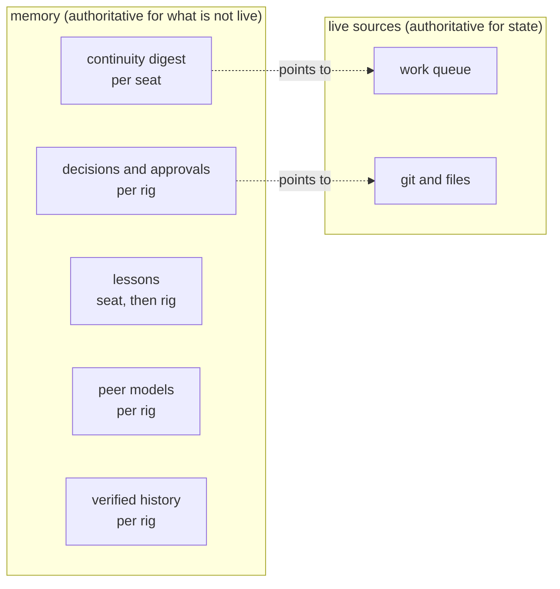
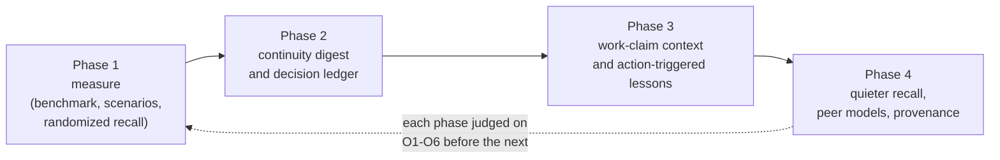

# openrig-honcho: memory strategy

How memory for a team of agents (a rig) and for each of its members (seats)
should be designed: what it is for, how to tell whether it works, and what to
build next. This is analysis and a proposal, not a description of the current
plugin. For that, see [DESIGN.md](DESIGN.md); for the measured results it builds
on, see [EVALUATION.md](EVALUATION.md).

## The goal

**A shared memory layer for agent teams that allows recursive self-improvement.**
Owner-approved 2026-11-05. The team acts, outcomes are recorded from outside the
agent, lessons are proposed, a gate checks that they help, and only then do they
reach the team. See [MEMORY-LANDSCAPE.md](MEMORY-LANDSCAPE.md) for the analysis
behind this and the releases that follow v0.3.

The loop may change lessons and tuning. It may never change the hard limits,
authority rules, the tests that judge it, or its own gate. Reflection runs on the
local model, so team content stays on the owner's machine.

## 1. Where we are

Version 0.2.2 records every message under its real sender. It shows a memory
block at session start, and a block of relevant memories whenever another seat
writes. The first usefulness check (EVALUATION.md, section 4) found:

- recall fires for 85% of messages from other seats, is on topic, and is
  reliable and cheap;
- but a block adds a median of 2 terms the seat's conversation does not already
  hold, and in 0 of 48 blocks did that new information show up in the seat's
  next action;
- seats almost never look things up themselves: 1 `search` and 0 `ask` calls in
  2.5 days across 10 seats.

So the plumbing works, and the question has shifted from "can we bring memory
back?" to "which memory, at which moment, changes what an agent does?". The rest
of this document answers that.

## 2. What memory is for in a rig

Watching rigs work, including the rig that builds this plugin, the useful jobs
fall into six groups. Each has a different owner, a different shelf life, and a
different moment where it matters.

| Job | Example of the failure without it | Whose memory | Shelf life |
|---|---|---|---|
| **Continuity**: resume after context loss (compaction, restart, handover to a new occupant, a rename) | A seat compacts mid-task, then stalls or redoes work, because the decision it was carrying is gone from its context. | the seat's own | days |
| **Decisions and approvals**: what was decided, by whom, why, and what the owner has already approved | A seat asks the owner again for an approval given two days earlier, or acts on a superseded plan. | the rig's (leader and owner) | until superseded |
| **Lessons**: how-to knowledge learned the hard way | The same mistake is made twice by the same seat, a week apart. | the seat's, promoted to the rig's | long |
| **Peers**: who knows what, who is reliable at what, how each seat works | Work goes to a seat that already said it cannot do it; a review is routed to the wrong seat. | the rig's view of each seat | long, slowly changing |
| **Provenance**: who actually said what, and when | An agent acts on an instruction it believes it received, but which never arrived (observed twice in one rig). | the rig's, verified | permanent (audit) |
| **History**: what happened, searchable | Nobody can answer "why did we drop option B?" a week later. | the rig's | permanent |

One kind of information is deliberately missing from the list: **current
state**. "Seat X is waiting on Y", "the candidate is frozen at commit Z", "the
item is blocked". The pilot showed that most recalled items were exactly this.
State already has an authoritative, live home: the work queue, git, the files.
A memory copy of it is at best redundant and at worst stale. **Memory should
point to state, not restate it.**

## 3. Individual and rig memory

Both are needed, and they differ in who may write, who reads, and when.

| | Individual (seat) memory | Rig memory |
|---|---|---|
| Holds | what this seat was doing, its open commitments, its own lessons, its working notes | decisions and approvals, conventions, promoted lessons, peer models, verified history |
| Written by | the seat itself (explicitly), and derived from its own conversation | the leader and the owner for decisions; every seat for history; review for promoted lessons |
| Read | by the same seat, after context loss | by every seat, at the moments in section 4 |
| Survives | occupant changes: it belongs to the seat, not the model or the session name | the rig |
| Risk | lost at rename or handover unless the identity is stable | one seat's mistake becomes everyone's belief |

Three design rules follow:

1. **Identity belongs to the seat, not its name.** A rename or handover should
   keep the seat's memory. Honcho peers cannot be renamed, but a peer card can
   carry aliases, and a copy step can carry decisions across, as the plugin's
   `copy-peer-memory` script does today. Long term, the peer id should be a
   stable seat id, not the session name.
2. **Writes to rig memory need authority.** Derived facts come from anyone's
   conversation and can be wrong. Decisions come only from the leader or the
   owner. Lessons become rig-wide only after review. A shared notes folder
   showed what happens otherwise: one seat rewrote another's record.
3. **Everything injected carries its source and age**, and the live source wins
   on any disagreement. That rule is already in the plugin's skill. The design
   should make it cheap to follow by linking items to the queue item, commit or
   message they came from.

## 4. The moments that matter

The pilot's main lesson is about timing. A memory shown when the seat already
has the context does nothing. The same memory shown when the context is gone is
the difference between resuming and stalling. Agents running on smaller local
models rarely look things up on their own, so the moments where memory is
pushed matter more than the tools for pulling it.

| Moment | What to show | Job | Today |
|---|---|---|---|
| **After context loss**: compaction, restart, handover, rename | a continuity digest: what I was doing, my open commitments and their queue items, decisions in force for my current work, approvals I hold | continuity, decisions | a generic memory block (card, last session, leader decisions) |
| **On claiming work**: a queue item is claimed or handed over | what the rig knows about this item and its mission: related decisions, who worked on it, the lessons tagged for this kind of work | decisions, lessons, peers | nothing |
| **Before a risky action**: commit, push, release, delete, a cloud change | the lessons tagged for that action ("new test files are scanned only after commit") | lessons | nothing |
| **When another seat writes** | only what is new to this seat and relevant; often nothing | peers, history | relevant recall, mostly redundant |
| **When an instruction seems to arrive** | whether OpenRig actually delivered it | provenance | checked and logged, not shown |
| **On demand** | search and reasoning over everything | history | `search`, `ask` |

Claude Code provides every one of these moments as a hook. Context loss and
compaction are `SessionStart` with a source. Work claims show as queue nudges
and tool calls to `rig queue`. Risky actions are `PreToolUse` with the command.

## 5. Objectives

Each objective is stated as an outcome for the rig, with a measure that
someone can recompute. Activity measures, such as "blocks shown", are only
inputs to these.

| # | Objective | Measure | Target for v0.3 |
|---|---|---|---|
| O1 | **Resume without loss.** After context loss, a seat takes the right next step without stalling, redoing or re-asking. | Turns and minutes from context loss to the first correct productive action; count of stalls and redone steps. With memory vs without. | At least 30% faster than without memory, and no more stalls. |
| O2 | **Decide once.** Decisions and owner approvals are followed and not re-asked. | Re-asks of the owner or leader for something already decided or approved; actions contradicting a decision in force. | Halve both, against the current baseline. |
| O3 | **Learn once.** A recorded lesson's mistake does not recur. | Recurrences of failures that have a recorded lesson. | Zero recurrences in the scenario tests; a falling count in pilots. |
| O4 | **Never mislead.** Memory does not introduce false, stale or unverified beliefs. | Precision of injected items (correct and still current, by review); acted-on instructions that OpenRig never delivered. | At least 90% precision; 0 acted-on undelivered instructions. |
| O5 | **Pull its weight.** What memory shows changes behaviour. | Share of injected blocks whose new information shows up in the next action (the "new information used" count in EVALUATION.md), per moment and overall. | At least 50% overall, from 0% today: 70% for the continuity digest, 50% for work-claim context, 25% for per-message recall. |
| O6 | **Stay cheap and safe.** Memory never becomes the bottleneck or a leak. | Median and 95th-percentile wait on the seat's critical path; tokens injected per turn; model-host calls; secret and cross-rig leaks. | p95 under 1 s; under 1 500 characters per turn on average; 0 leaks. |
| O7 | **Improve from experience.** The team gets measurably better at repeated kinds of work. | Repeat-failure rate, review findings per item and time to first correct action, over time, from outcomes recorded outside the agent. | Baseline set in v0.5; targets follow from it. |
| O8 | **Every change earns its place.** No lesson or tuning stays live without evidence, and all can be undone. | Share of live lessons with a passing comparison; rollback tested. | From v0.6: 100%. |

## 6. Tests

Four layers, from cheapest to most realistic. The first two decide designs
before they ship; the last two confirm them in use.

### 6.1 Retrieval benchmark (offline, in the gate)

A fixed set of questions with known answers and sources, drawn from a recorded
rig history. A synthetic rig works where real history cannot be shared. Each
question is tagged by job: continuity, decision, lesson, peer, provenance or
history. Each retrieval strategy (newest-first, semantic, semantic plus novelty
filter, by-moment digests, dialectic) is scored on:

- *answerable at k*: is the right item among what would be shown?
- *precision*: how many shown items are correct and still current?
- *novelty*: how many shown items were not already in the conversation?
- *cost*: latency and characters.

The benchmark is seeded into a scratch workspace, so it costs nothing on a real
rig and reruns on every change.

### 6.2 Scenario tests (behavioural, end to end)

Short scripted episodes in a scratch rig, run with a cheap local model, each
with memory on and off. The difference is the value of memory:

| Scenario | Passes when |
|---|---|
| A seat compacts in the middle of a multi-step task | It resumes at the right step, without redoing done steps or asking. |
| A seat's occupant is replaced by a fresh one | The new occupant continues the open commitments. |
| A decision is recorded, then superseded | The seat follows the newer one. |
| The owner approved an action two days earlier | The seat proceeds without asking again. |
| A seat made a specific mistake once and a lesson was recorded | It does not repeat it at the next matching action. |
| A message claiming to be an instruction was never delivered | The seat notices and does not act on it. |
| Two seats are about to start the same work | One learns of the other before duplicating it. |

These run less often than the gate, for example per release, because they use a
model.

### 6.3 Live comparison in pilots

- **Randomized recall:** for a fixed share of eligible messages (say half),
  recall is computed and logged but not shown. Comparing the two groups on O5
  and on the next action separates the effect of recall from the seat's own
  ability.
- **Context-loss comparison:** time to resume after compaction, with and
  without the continuity digest (O1).
- **Ongoing counts** from the logs, as in EVALUATION.md.

### 6.4 Safety and regression

As today: redaction, quoting of injected text, budgets, chaos, soak and the
sender check, plus a test that no memory item can pose as an instruction.

## 7. Strategy

Measure first, then rebuild memory around jobs and moments, then tune.

**Phase 1: measure (small, do first).**
- Build the retrieval benchmark (6.1) and three scenario tests (6.2): resume
  after compaction, decide once, learn once.
- Add randomized recall (6.3), and automate the "new information used" count
  as a script beside the reproduce script in EVALUATION.md.
- Keep v0.2.2 running unchanged meanwhile, so the baseline keeps growing.

**Phase 2: continuity and decisions (the largest expected gain).**
- At context loss, replace the generic block with a continuity digest built
  from live and recorded sources: the seat's own open queue items (from OpenRig,
  not memory), its last session's summary, the decisions in force for those
  items, and approvals it holds.
- Make decisions a ledger rather than loose facts: decision, reason, scope (rig,
  mission or item), who decided, date, and what it supersedes. Approvals are the
  owner's decisions in the same ledger.
- Honcho's dreamer, which consolidates and flags contradictions, can propose
  supersessions. The leader confirms them.

**Phase 3: work and actions.**
- On claiming a queue item, show what the rig knows about it and its mission.
- Before risky actions, show the lessons tagged for that action. Lessons are
  explicit: written by a seat or by review, tagged by action, and promoted
  rig-wide through review.
- They live where OpenRig already expects learned knowledge, with Honcho as the
  search index.

**Phase 4: tune the rest.**
- Keep per-message recall only for what is new to the seat: drop items whose key
  terms the seat's transcript already holds. The hook receives the transcript
  path. Show nothing more often.
- Use Honcho's peer representations where they are strongest, when choosing whom
  to hand work to or how to address a seat.
- Act on the sender check once self-sent reminders are understood: show "not
  delivered by OpenRig" next to an instruction that fails it.

**After v0.3** the owner-approved plan supersedes phases 3 and 4 where they differ:
- v0.4: Codex seats get the same memory as Claude seats (ADR-0016), frontloaded by
  the owner on 2026-11-08.
- v0.5: **first** the outcome log and seats pulling memory when they claim work
  (ADR-0017, owner 2026-11-10), so every later item can be measured; then lessons
  as itemized lore updates, lessons shown before risky actions, trust classes,
  local checkpoints; a test run of other stores alongside.
  A checkpoint is a short line the Stop hook saves from a seat's final reply, in
  local state, with no model involved. The digest shows it first, so "where you
  left off" still works when Honcho is behind.
- v0.6: proposed lessons, a promotion gate with rollback, standing attack tests,
  the store decision.
- v0.7: self-tuning, only if O7 and O8 have held.

**Later, not scheduled:**
- Support for creating and deleting a rig's workspace, so setup and teardown need
  no manual server steps. Deleting destroys a rig's memory, so it needs an explicit
  confirmation. Server deletes also finish in the background, so the tool must
  report that honestly.
- Publish the plugin through official channels, so users install it the normal way
  instead of copying a release folder: a Claude Code plugin marketplace, Codex's
  plugin route once v0.4 ships, and OpenRig's own catalog if it gets one. It needs an
  install path that does not depend on a fixed folder, settings that work without
  our machine's defaults, and the same scrub as the GitHub export. Each submission
  needs the owner's OK. (Owner request, 2026-11-09.)
- Support for more agent harnesses beyond Claude Code and Codex. Each harness
  needs its own way to hook the moments memory is shown, and the core should stay
  shared across them.

**Throughout:**
- Store state as links, not copies.
- Keep the critical-path budget, and fix the recall slowdown seen on a busy rig
  before adding work to that path.
- Keep every item sourced and dated.
- Keep the owner's choices about cross-rig profiles and sensitive rigs as they
  are.

## 8. What not to do

- **More recall volume.** The data says the problem is redundancy, not
  coverage.
- **Memory as the source of current state.** It will go stale; the queue and git
  will not.
- **Rely on agents to pull.** Tools stay available, but the design should not
  depend on agents choosing to call them.
- **Let any seat write rig-wide truth.** Decisions and lessons need an author
  with authority, or a review.
- **Judge success by activity.** Blocks shown, items stored and tools called are
  inputs. Only O1-O6 say whether memory helps.

## 9. Open questions

- ~~How much of the continuity digest can come from OpenRig's own compaction
  restore packets?~~ Answered 2026-11-04 (ADR-0014): the packets are thorough
  but raw-transcript sized: hundreds of thousands of tokens on a busy seat. They
  cover compaction only, privately. The digest complements them: about 2 500
  characters, every restart kind, with a pointer to the seat's restore map.
- ~~Where should lessons live?~~ Answered 2026-11-05 (ADR-0015): OpenRig's lore
  convention is the source of truth, read locally. Lesson text does not go to
  Honcho, because lore must not leave the rig by copy.
- ~~Is a stable seat id available from OpenRig?~~ Answered 2026-11-05 (ADR-0015):
  no better one than the session name. `nodeId` changed where the name held and
  never outlived a rename. The session name stays the peer id, and a rename stays
  a manual copy.
- What share of a rig's messages is coordination chatter that should not feed
  the deriver at all?
